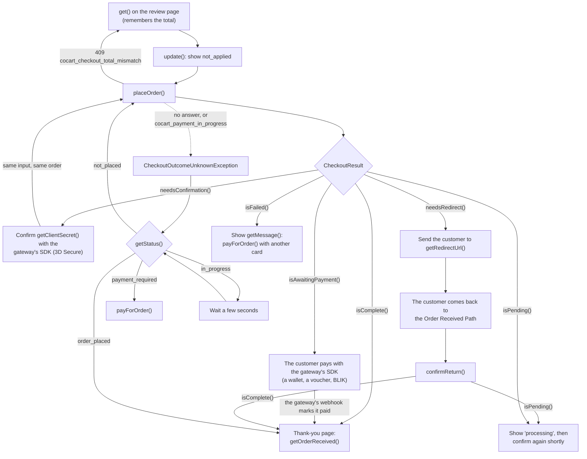

# Checkout

> Requires **CoCart Plus 2.0** and at least one WooCommerce payment gateway.

Checkout turns the customer's cart into an order and takes payment. Your PHP code runs on the server, so **card details never reach it**:
- The browser collects the card with the gateway's own JavaScript (for Stripe, Stripe.js with your publishable key) and gives you a payment method ID.
- You place the order with that ID.

- [How It Works](#how-it-works)
- [One Client per Customer](#one-client-per-customer)
- [Quick Start](#quick-start)
- [Showing the Checkout](#showing-the-checkout)
- [Placing the Order](#placing-the-order)
- [Reading the Result](#reading-the-result)
- [3D Secure in the Page](#3d-secure-in-the-page)
- [Paid Outside the Checkout: Wallets, Vouchers, BLIK](#paid-outside-the-checkout-wallets-vouchers-blik)
- [Off-Site Steps](#off-site-steps)
- [Saved Cards](#saved-cards)
- [The Thank-You Page](#the-thank-you-page)
- [Paying for an Unpaid Order](#paying-for-an-unpaid-order)
- [Address Autocomplete](#address-autocomplete)
- [Errors Before Payment](#errors-before-payment)
- [When No Answer Comes Back](#when-no-answer-comes-back)
- [Changing a Subscription's Payment Method](#changing-a-subscriptions-payment-method)

## How It Works

1. **Show the cart**, then the review page with **`get()`**: CoCart Plus remembers the total it showed the customer. Call it for the page the customer reviews, not just before placing the order.
2. **Save what the customer enters** with **`update()`**, and show what wasn't applied (`result.not_applied`).
3. **The browser turns the card into a payment method ID** with the gateway's JavaScript.
4. **`placeOrder()`** creates the order and takes payment.
5. **Act on the result:**

   | Result | What to do |
   |---|---|
   | `isComplete()` | Show the thank-you page (`getOrderReceived()`) |
   | `isAwaitingPayment()` | The order is placed; the customer pays with the gateway's SDK (a wallet, a voucher, BLIK) |
   | `needsConfirmation()` | The browser confirms the card (3D Secure), then you make the same call again |
   | `needsRedirect()` | Send the customer off-site, then call `confirmReturn()` when they're back |
   | `isPending()` | The gateway hasn't confirmed yet: confirm again shortly |
   | `isFailed()` | Show `getMessage()`, and pay again with `payForOrder()` |

6. **No answer, or `cocart_payment_in_progress`:** `placeOrder()` throws `CheckoutOutcomeUnknownException`. Ask `getStatus()`: `payment_required` → `payForOrder()`; `in_progress` → ask again; `not_placed` → place the order again.
7. **`409 cocart_checkout_total_mismatch`:** the total changed since the review page. Get the checkout again and show the new total.

The whole flow, including the lock CoCart Plus takes so that a double tap, or a request sent again, can't take payment twice:



The client never sends `placeOrder()` again by itself, since it may already have run on the store. When no answer comes back, `placeOrder()` throws `CheckoutOutcomeUnknownException`: see [When No Answer Comes Back](#when-no-answer-comes-back).

## One Client per Customer

The client uses the customer's cart session, so create it the same way as for the cart: the guest's cart key, or the customer's login.

```php
$client = new CoCart('https://your-store.com', [
    'cart_key' => $cartKey, // or 'jwt_token' => $token for a logged-in customer
]);
```

On a server, make **one client per customer** (per web request, from that customer's session). A client holds one cart key, one login and the last response; sharing one between customers, for example in a long-running worker, would place one customer's order with another's cart.

## Quick Start

In the browser, with Stripe.js and your **publishable** key:

```js
const stripe = Stripe('pk_test_…');
const elements = stripe.elements({ mode: 'payment', amount: 2500, currency: 'eur', paymentMethodCreation: 'manual' });
elements.create('payment').mount('#payment-element');

// On submit:
await elements.submit();
const { paymentMethod, error } = await stripe.createPaymentMethod({ elements });
// POST paymentMethod.id to your server
```

On your server:

```php
$result = $client->checkout()->placeOrder([
    'billing_address' => [
        'first_name' => 'Jane',
        'last_name'  => 'Doe',
        'address_1'  => '1 Main Street',
        'city'       => 'Paris',
        'postcode'   => '75001',
        'country'    => 'FR',
        'email'      => 'jane@example.com',
    ],
    'shipping_method' => 'flat_rate:1',
    'payment_method'  => 'stripe',
    'payment_data'    => ['wc-stripe-payment-method' => $_POST['payment_method_id']],
]);

if ($result->isComplete()) {
    header('Location: /thank-you?order=' . $result->getOrderId() . '&key=' . urlencode($result->getOrderKey()));
    exit;
}
```

The rest of this page covers the other results.

## Showing the Checkout

`get()` returns the checkout as it stands, like a receipt. Call it for the page the customer reviews before paying: CoCart Plus remembers the total it showed, and refuses the order if the total has changed by then (`409 cocart_checkout_total_mismatch`). Don't call it just before placing the order, or the check can't catch a change the customer never saw.

```php
$checkout = $client->checkout()->get();

$checkout->get('payment.needs_payment');   // false when the order is free
$checkout->get('delivery.needs_shipping');
$checkout->get('delivery.packages');       // each package with its rates and the one chosen
$checkout->get('items');
$checkout->get('totals.total');            // in minor units, e.g. '2300'
$checkout->get('total_lines');             // the lines a receipt prints, which add up to the total
$checkout->get('customer.billing');
```

It takes optional parameters:

```php
$checkout = $client->checkout()->get([
    'currency'  => 'EUR', // with a currency switcher
    'formatted' => true,  // amounts formatted for display instead of minor units
    'thumb'     => false, // leave out item thumbnails
]);
```

Save what the customer has entered so far, without placing the order. The totals, taxes and shipping rates update to match:

```php
$checkout = $client->checkout()->update([
    'billing_address' => ['country' => 'FR', 'postcode' => '75001'],
    'shipping_method' => 'flat_rate:1',
    'coupon_code'     => 'SUMMER10',
    'coupon_action'   => 'apply', // or 'remove'
]);

$checkout->get('result.code'); // 'checkout_updated', or 'checkout_partly_updated'

foreach ($checkout->get('result.not_applied', []) as $skipped) {
    // What wasn't applied, and why: show it next to the field.
    echo $skipped['field'] . ': ' . $skipped['message']; // 'shipping_method: The shipping method "local_pickup:999" is not available.'
}
```

Every address field at fault is reported at once: see [Errors Before Payment](#errors-before-payment).

The store's form settings: fields, required fields per country, the countries it sells and ships to, and whether guests can check out. This call doesn't need a cart:

```php
$config = $client->checkout()->getConfig();

$config->get('fields.billing');
$config->get('countries');
$config->get('account');                       // e.g. whether a guest can create an account at checkout
$config->get('order_received_url');            // where customers come back after an off-site step
$config->get('address_autocomplete.enabled');  // whether searchAddresses() works
$config->get('store.terms_text');              // 'I have read and agree to the website terms and conditions'
$config->get('store.terms_links');             // [['text' => 'terms and conditions', 'url' => '…']]
$config->get('store.terms_url');
$config->get('store.privacy_url');
```

The payment methods the customer can use for this cart:

```php
foreach ($client->checkout()->getPaymentMethods()->get('payment_methods', []) as $method) {
    echo $method['id'];          // 'stripe'
    echo $method['title'];       // 'Credit card'
    echo $method['description'];
    $method['test_mode'];
    $method['supports']['subscriptions']; // the gateway can charge renewals
}
```

## Placing the Order

```php
$result = $client->checkout()->placeOrder([
    'billing_address'  => [...],
    'shipping_address' => [...],      // when it differs from billing
    'shipping_method'  => 'flat_rate:1',
    'customer_note'    => 'Leave at the door',
    'payment_method'   => 'stripe',
    'payment_data'     => ['wc-stripe-payment-method' => $paymentMethodId],
]);
```

| Field | Notes |
|---|---|
| `billing_address` | `first_name`, `last_name`, `address_1`, `city`, `postcode`, `country` and `email` at least, plus what `getConfig()` marks required |
| `shipping_address` | Same fields, when shipping goes elsewhere |
| `shipping_method` | A rate ID from `get('delivery.packages')` |
| `payment_method` | A gateway ID from `getPaymentMethods()`: `stripe`, `woocommerce_payments`, `paypal`, `bacs`, `cod`…; leave it out for a free order |
| `payment_data` | What the gateway needs, as a map (below) |
| `customer_note` | Optional |
| `create_account`, `customer_password` | Create an account for a guest, when the store allows it |
| `checkout_id` | Optional: your own ID for this checkout, 16 to 64 letters, digits, `-` or `_` (see [When No Answer Comes Back](#when-no-answer-comes-back)) |

`payment_data` holds the keys the WooCommerce gateway reads. It carries **gateway tokens only** (a payment method ID, a saved card's ID, a nonce): never card numbers, CVCs or anything else the browser collected about the card.

| To… | Key | Value |
|---|---|---|
| Charge a new Stripe card | `wc-stripe-payment-method` | The payment method ID (`pm_…`) |
| Charge a new WooPayments card | `wcpay-payment-method` | The payment method ID |
| Charge a saved card | `wc-{gateway}-payment-token` | The saved card's `id` (see [Saved Cards](#saved-cards)) |
| Save the new card for later | `wc-{gateway}-new-payment-method` | `true` |

Offline gateways (`bacs`, `cheque`, `cod`) need no `payment_data`. A free order (`payment.needs_payment` is `false`) needs neither `payment_method` nor `payment_data`.

Calling `placeOrder()` again for the same cart, after a confirmation or a failure, updates the same order rather than creating a second one.

## Reading the Result

`placeOrder()`, `payForOrder()`, `confirmReturn()` and `account()->updateSubscriptionPaymentMethod()` return a `CheckoutResult`, read from the `result` CoCart Plus sends with the order (or the subscription). A declined card is a result (`isFailed()`), not an exception.

```php
$result = $client->checkout()->placeOrder($input);

if ($result->isComplete()) {
    // Paid, free, or held for review or offline payment: show the thank-you page.
} elseif ($result->isAwaitingPayment()) {
    // Placed, but the customer pays outside the checkout: a wallet, a voucher, BLIK.
} elseif ($result->needsConfirmation()) {
    // The card needs 3D Secure in the page.
} elseif ($result->needsRedirect()) {
    // The payment needs an off-site step.
} elseif ($result->isPending()) {
    // The gateway hasn't confirmed yet: confirm again shortly.
} else {
    // Failed.
    echo htmlspecialchars($result->getMessage()); // 'Your card was declined.'
    echo $result->getErrorCode();                 // 'card_declined'
}
```

| Method | Returns |
|---|---|
| `getCode()` | `result.code`: `'order_placed'`, `'action_required'`, `'payment_pending'`, `'payment_failed'`, or `'payment_method_changed'` for a subscription. A value a store or gateway adds comes through as it is |
| `isComplete()` | `true` for `order_placed` or `payment_method_changed` with no action left |
| `isAwaitingPayment()` | `true` for `order_placed` with an action: the order is placed but the customer still pays ([wallets, vouchers, BLIK](#paid-outside-the-checkout-wallets-vouchers-blik)) |
| `needsConfirmation()` | `true` for `action_required` with a client secret: an in-page step |
| `needsRedirect()` | `true` for `action_required` with an off-site address and no client secret |
| `isPending()` | `true` for `payment_pending`: the gateway hasn't confirmed yet |
| `isFailed()` | `true` for `payment_failed` |
| `getObject()` | `'order'`, or `'subscription'` after a subscription's payment method change |
| `getOrderId()`, `getOrderKey()`, `getOrderNumber()`, `getOrderStatus()` | The order's ID, key, number (for display) and status code (`processing`, `on-hold`, `pending`…), when the document is an order |
| `getSubscriptionId()` | The subscription's ID, when the document is a subscription |
| `getRedirectUrl()` | The off-site step when `needsRedirect()`, otherwise the page to show once the payment is done. Only ever an `https` or `http` address: anything else in the response (a `javascript:` URL, another app's link) is left out |
| `getClientSecret()`, `getIntentType()` | For [3D Secure in the page](#3d-secure-in-the-page), or a payment made in the page |
| `getPaymentMethodType()` | For `isAwaitingPayment()` with Stripe: `cashapp`, `wechat_pay`, `boleto`, `oxxo` or `multibanco` |
| `getMessage()` | A message for the customer, for every code: why it failed, or that the order was received |
| `getErrorCode()` | With `isFailed()`: CoCart's code to branch on (below) |
| `getGatewayErrorCode()`, `getGatewayMessage()` | With `isFailed()`: the gateway's own code and message, for your logs |
| `getActionType()`, `getActionData()` | What the customer must do, as the gateway integration names it, and what it needs |
| `getResponse()` | The raw `Response`: the order, or the subscription |

`getMessage()` and `getGatewayMessage()` are **plain text**: escape them when you put them in a page (`htmlspecialchars()`).

`var_dump()` and `print_r()` of a result mask the client secret, the order key and URL query values, and leave out the raw response, so a dumped result doesn't put them in your logs. The getters still return them.

An offline gateway (`bacs`, `cheque`, `cod`), or a payment the store reviews (manual capture, a fraud check), is `order_placed` with the order `on-hold`: `isComplete()`, not an error.

**Why a payment failed (`getErrorCode()`):**

| Code | Meaning |
|---|---|
| `card_declined` | Declined, including for fraud |
| `insufficient_funds` | Not enough funds |
| `expired_card` | The card has expired |
| `incorrect_cvc`, `incorrect_number`, `incorrect_postcode` | Wrong details |
| `authentication_failed` | 3D Secure failed or was cancelled |
| `processing_error` | The gateway had a problem; try again |
| `payment_method_not_supported`, `amount_not_supported` | The gateway can't take this payment |
| `payment_failed` | The gateway didn't say why |

Stripe and WooPayments report the specific reasons. Other gateways give `payment_failed`.

## 3D Secure in the Page

Some cards need the customer to approve the payment with their bank.

1. Your server sends `getClientSecret()` to the browser.
2. Stripe.js shows the bank's step.
3. Your server makes the same call again (`placeOrder()` with the same input, or `payForOrder()`).

```php
if ($result->needsConfirmation()) {
    echo json_encode(['client_secret' => $result->getClientSecret()]);
    exit;
}
```

```js
const { error } = await stripe.handleNextAction({ clientSecret });
if (!error) {
  // Ask your server to place the order again.
}
```

The second `placeOrder()` finds the confirmed payment and completes the same order.

## Paid Outside the Checkout: Wallets, Vouchers, BLIK

With some payment methods the order is placed before the customer pays, so `isAwaitingPayment()` is `true` rather than `isComplete()`. The cart has already been emptied. The gateway's webhook marks the order paid, so **don't place the order again**.

With Stripe's Cash App Pay, WeChat Pay and vouchers, there's a client secret:

1. Your server sends `getClientSecret()`, `getPaymentMethodType()` and `getRedirectUrl()` to the browser.
2. Stripe.js takes the payment, as the Stripe gateway's own checkout does: it shows a QR code, sends the customer to Cash App on a phone (and back to `getRedirectUrl()`), or shows the voucher.

| `getPaymentMethodType()` | Stripe.js call |
|---|---|
| `cashapp` | `confirmCashappPayment(clientSecret, { return_url })`, or `confirmCashappSetup()` for a `seti_…` secret (a free trial) |
| `wechat_pay` | `confirmWechatPayPayment(clientSecret, { payment_method_options: { wechat_pay: { client: 'web' } } })` |
| `boleto`, `oxxo`, `multibanco` | `confirmBoletoPayment(clientSecret)`, `confirmOxxoPayment()` or `confirmMultibancoPayment()` |

Without one, `getActionType()` says what to show, and `getActionData()` has what it needs:

| `getActionType()` | Show |
|---|---|
| `stripe_blik_confirmation_pending` | Ask the customer to approve the payment in their banking app |
| `wcpay_multibanco_voucher` | The voucher: `entity`, `reference`, `voucher_url`, `expires_at` |
| A bank transfer's instructions | What the action data holds |

`checkout()->getStatus()` says `payment_required` until the payment goes through, then `order_placed`. A voucher is paid later, at a bank or a shop. If the customer gives up, the order stays unpaid, and `payForOrder()` takes another payment for it.

## Off-Site Steps

Some payments finish on another site: PayPal approval, or a Stripe-hosted 3D Secure page.

```php
if ($result->needsRedirect()) {
    header('Location: ' . $result->getRedirectUrl());
    exit;
}
```

The customer comes back to your thank-you page: the **Order Received Path** set in CoCart Plus under Settings → Checkout (`/checkout/order-received/{order_id}/` by default), on your **Front-end site URL**. The URL carries the order key (`key`) and the gateway's parameters. Serve that path, and hand the URL to `confirmReturn()` there. If the setting changes, change your route to match:

```php
$result = $client->checkout()->confirmReturn($_SERVER['REQUEST_URI']);

if ($result->isComplete()) {
    // Show the thank-you page.
} elseif ($result->isPending()) {
    // The gateway hasn't confirmed yet: show "processing" and confirm again shortly.
} else {
    echo htmlspecialchars($result->getMessage()); // Declined or cancelled: offer payForOrder().
}
```

`confirmReturn()` is safe to call more than once: a paid order comes back as `order_placed`. If your route carries the order elsewhere, pass it: `confirmReturn($url, orderId: 123, orderKey: 'wc_order_…')`. The order key goes in the request body, never in the URL.

`getConfig()` gives the URL customers come back to as `order_received_url`, e.g. `https://shop.example.com/order/{order_id}?key={order_key}&order_id={order_id}`, so you know which route (or, in an app, which link) to handle.

A subscription's payment method change can send the customer off-site too (a bank, for example). They come back the same way, and the same return call finishes the change: `getObject()` is `'subscription'`, with `getSubscriptionId()`; `isComplete()` once the new payment method is set (`payment_method_changed`), `isFailed()` when it wasn't confirmed.

## Saved Cards

A logged-in customer's saved payment methods, for gateways that support them (empty for a guest):

```php
foreach ($client->checkout()->getSavedPaymentMethods() as $card) {
    echo $card['id'];         // 7
    echo $card['gateway_id']; // 'stripe'
    echo $card['label'];      // 'Visa ending in 4242'
    echo $card['type'];       // 'CC'
    echo $card['expires'];    // '12/2030', or null
    $card['is_default'];
    $card['supports_subscriptions']; // the gateway can charge renewals
}

// Only one gateway's saved methods:
$cards = $client->checkout()->getSavedPaymentMethods('stripe');
```

Pay with one:

```php
$result = $client->checkout()->placeOrder([
    // ...
    'payment_method' => 'stripe',
    'payment_data'   => ['wc-stripe-payment-token' => $card['id']],
]);
```

To save a new card, add `'wc-stripe-new-payment-method' => true` next to `wc-stripe-payment-method`.

## The Thank-You Page

For a guest, pass the order key; a logged-in customer must own the order. A wrong key, or someone else's order, is `404 cocart_order_not_found`.

```php
$order = $client->checkout()->getOrderReceived($orderId, $orderKey);

$order->get('number');
$order->get('status.label');           // 'Processing'
$order->get('items');
$order->get('total_lines');            // the totals as a receipt prints them, in order
$order->get('payment.needs_payment');  // true if the customer still has to pay

// Amounts formatted for display, and order meta the store allows:
$order = $client->checkout()->getOrderReceived($orderId, $orderKey, [
    'formatted' => true,
    'meta_keys' => ['gift_message'],
]);
```

## Paying for an Unpaid Order

When `payment.needs_payment` is `true` (the payment failed, or the customer left), take payment for the same order:

```php
$result = $client->checkout()->payForOrder($orderId, $orderKey, [
    'payment_method' => 'stripe',
    'payment_data'   => ['wc-stripe-payment-method' => $paymentMethodId],
]);

if ($result->isComplete()) {
    // Paid.
} elseif ($result->needsConfirmation() || $result->needsRedirect()) {
    // As for placeOrder(): confirm the card, or send the customer off-site.
} else {
    echo htmlspecialchars($result->getMessage());
}
```

It returns the same `CheckoutResult` as `placeOrder()`, and you read it the same way:

- a declined card is `isFailed()`, not an exception;
- a card that needs 3D Secure gives `needsConfirmation()`: confirm it as in [3D Secure in the Page](#3d-secure-in-the-page), then call `payForOrder()` again;
- an off-site step gives `needsRedirect()`.

The order key is sent in the request body, not the URL. An order that needs no payment or can't be paid is a `409`, and so is another payment still running for it (`cocart_payment_in_progress`): here that's an ordinary `CoCartException`, since the order exists. `getOrderReceived()` lists the methods the order accepts in `payment.available_methods`.

## Address Autocomplete

When the store has an address provider set up (`getConfig()`'s `address_autocomplete.enabled`, with its `providers`). Without one, the search is `404 cocart_address_search_no_provider`. Neither call needs a cart.

```php
$found = $client->checkout()->searchAddresses('10 Downing', country: 'GB');

foreach ($found->get('suggestions') as $suggestion) {
    echo $suggestion['label']; // '10 Downing Street, London'
}

$details = $client->checkout()->getAddressDetails($suggestion['id'], $found->get('provider.id'));
$details->get('address'); // ['address_1' => '10 Downing Street', 'city' => 'London', 'postcode' => 'SW1A 2AA', 'country' => 'GB']
```

The search needs at least 3 characters.

## Errors Before Payment

When the store refuses the order before trying to take payment, `placeOrder()` throws a `CoCartException`, as other calls do. CoCart Plus checks the whole form at once, so every field at fault comes back together:

```php
use CoCart\Exceptions\CoCartException;

try {
    $result = $client->checkout()->placeOrder($input);
} catch (CoCartException $e) {
    $e->getErrorCode(); // e.g. 'cocart_invalid_address_fields'
    $e->getMessage();   // the first problem, to show the customer
    $e->getFields();    // ['billing.postcode' => 'Please enter a valid postcode.', ...]
    $e->getField();     // 'billing.postcode': the first field at fault, or null
    $e->getReason();    // the underlying plugin's own reason, or null
}
```

| Code | Meaning |
|---|---|
| `cocart_cant_checkout_empty_cart` | The cart is empty |
| `cocart_address_field_required`, `cocart_invalid_address_fields` | A required address field is missing or wrong (see `getFields()`) |
| `cocart_invalid_email_address`, `cocart_invalid_phone_number` | Invalid email or phone |
| `cocart_invalid_billing_postcode`, `cocart_invalid_billing_country_code` | Invalid billing postcode or country |
| `cocart_invalid_shipping_postcode`, `cocart_invalid_shipping_country_code` | Invalid shipping postcode or country |
| `cocart_no_shipping_method`, `cocart_invalid_shipping_method` | No shipping method chosen, or one that doesn't apply |
| `cocart_invalid_payment_method`, `cocart_payment_method_not_available`, `cocart_payment_method_disabled` | The payment method can't be used |
| `cocart_payment_method_no_subscription_support` | The cart has a subscription and the gateway can't renew it |
| `cocart_product_out_of_stock`, `cocart_insufficient_stock`, `cocart_product_not_purchasable`, `cocart_product_not_exists` | A product can't be bought any more |
| `cocart_invalid_coupon`, `cocart_coupon_usage_limit`, `cocart_coupon_email_restricted` | A coupon no longer applies |
| `cocart_account_exists`, `cocart_account_creation_failed` | `create_account` failed |
| `cocart_checkout_total_mismatch` (`409`) | The total changed since the review page: get the checkout again and show the new total |
| `checkout_invalid_checkout_id` | The `checkout_id` you passed isn't 16 to 64 letters, digits, `-` or `_`. A `ValidationException` thrown before anything is sent |

A `409`, a `429` or a `5xx` is always a plain `CoCartException`, never a `ValidationException`, whatever its code says.

## When No Answer Comes Back

If the connection drops, the request times out or a proxy gives up waiting, the order may or may not have been placed. The same is true when another request is still taking payment for the cart (a double tap, or a request sent again after a timeout): CoCart Plus answers `409 cocart_payment_in_progress`. Each order is sent with a random `checkout_id`, so in both cases `placeOrder()` throws `CheckoutOutcomeUnknownException` with that ID, and `getStatus()` asks CoCart Plus how the checkout ended. Ask from the same cart, or as the same customer.

```php
use CoCart\Exceptions\CheckoutOutcomeUnknownException;

try {
    $result = $client->checkout()->placeOrder($input);
} catch (CheckoutOutcomeUnknownException $e) {
    $status = $client->checkout()->getStatus($e->getCheckoutId());

    switch ($status['code']) {
        case 'order_placed':     // It went through: show $status['order_id'] with $status['order_key'].
        case 'payment_required': // Placed but not paid: payForOrder($status['order_id'], $status['order_key'], …).
        case 'in_progress':      // Still running: ask again in a few seconds.
        case 'not_placed':       // Nothing went through: placeOrder($input) again.
    }
}
```

`getStatus()` returns an array:

| Key | Value |
|---|---|
| `checkout_id` | The ID you asked about |
| `code` | `order_placed`, `payment_required`, `in_progress` or `not_placed` |
| `message` | A message for the customer |
| `order_id`, `order_key`, `order_number`, `order_status` | The order, or `null` unless it was placed or needs payment |

`CheckoutOutcomeUnknownException` keeps the original error's message, HTTP code and error code (0 and no code for a timeout or a dropped connection, the proxy's 502 or 504, or `409` with `cocart_payment_in_progress`). Pass your own `checkout_id` in the input if you'd rather keep it yourself: 16 to 64 letters, digits, `-` or `_`.

If the gateway's webhook paid the order after a 3D Secure confirmation in the page, placing the order again reports that order as complete rather than placing another.

## Changing a Subscription's Payment Method

See [Account](account.md#changing-a-subscriptions-payment-method).
